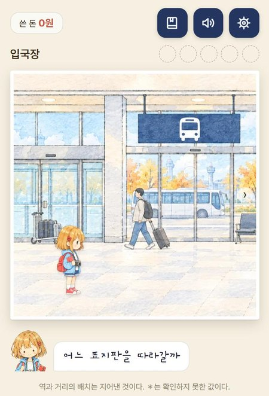
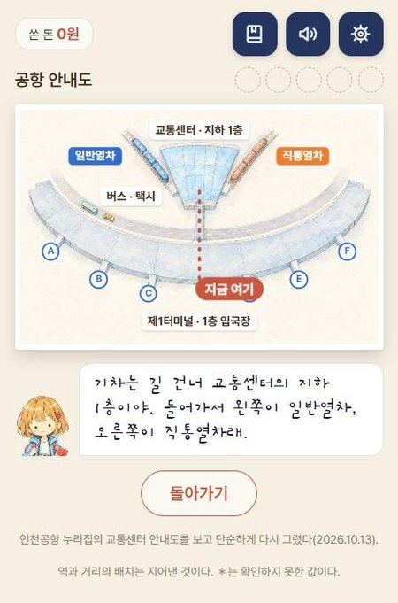
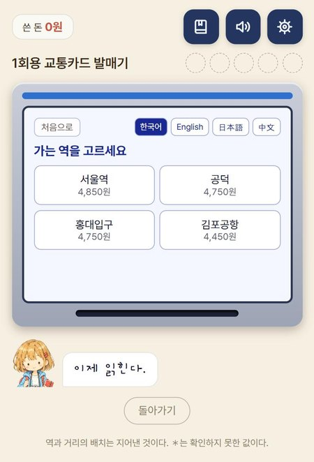
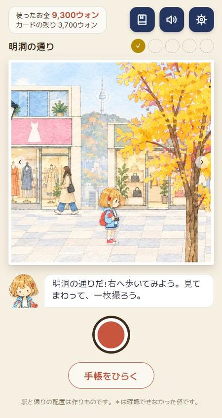
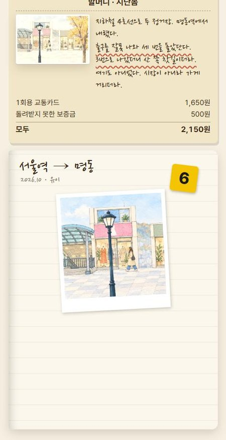
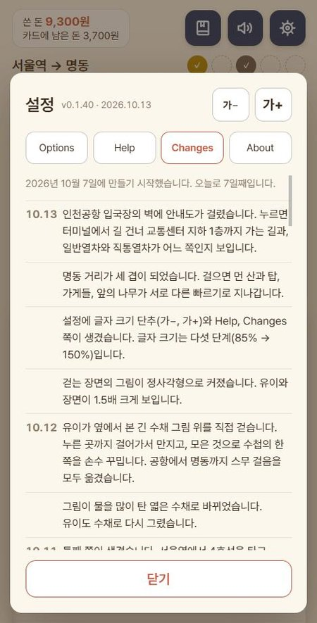
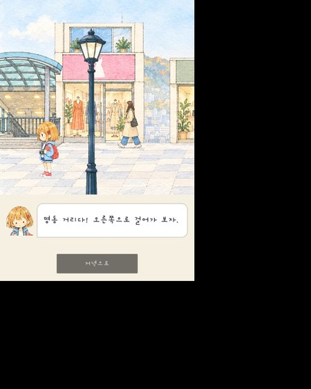
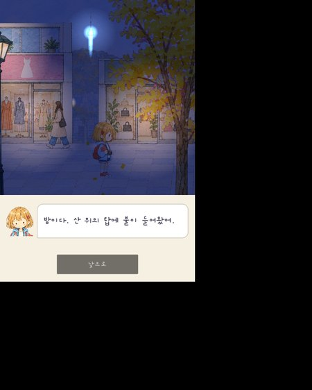

# Korea Oddity — 팔도 한량 (八道閑良)

일본 소녀 유이가 할머니의 수첩을 들고 서울을 대중교통으로 다니는 여행 어드벤처 게임이다. 공항에서 표를 사고, 개찰구와 출구를 찾고, 먹고, 찍어서 수첩에 붙인다.

이 게임을 다 익히면 외국 손님이 한국에서 혼자 다닐 수 있게 하는 것이 목표다. 노는 사람은 일본의 어른이 먼저이고, 그다음이 중국과 영어권이다.

[Space Oddity — 우주 한량](https://github.com/destory1984/oddity_claude)(1권), [Time Oddity — 시간 한량](https://github.com/destory1984/time-oddity_claude)(2권)의 다음 편이다. 1권이 "못 가는 곳", 2권이 "못 가는 때"였다면 3권은 "갈 수 있는 곳"이다.

## 바로 해 보기

손전화의 브라우저에서 연다. 세로 화면이다.

- 게임: https://destory1984.github.io/korea-oddity_claude/water/
- 일본어로 열기: https://destory1984.github.io/korea-oddity_claude/water/?lang=ja

말은 한국어, English, 日本語, 中文 넷이다. 설정(톱니)에서 바꾼다.

| 1. 입국장. 표지판을 따라 걷는다 | 2. 벽의 안내도 | 3. 1회용 교통카드 발매기 |
|:---:|:---:|:---:|
|  |  |  |

| 4. 명동 거리(일본어). 산 위에 탑이 보인다 | 5. 수첩의 쪽을 손수 꾸민다 | 6. 설정의 "바뀐 것들" |
|:---:|:---:|:---:|
|  |  |  |

## 무엇을 하는 게임인가

유이는 열두 살이다. 할머니 노리코는 2004년 가을, 쉰 살에 드라마 "가을연가"에 빠져 처음 한국에 왔다가 시장에서 길을 잃었고, 한 아주머니의 가게에서 밥을 얻어먹었다. 지난봄에 그 가게를 찾으러 다시 갔다가 헤매기만 했다. 유이가 수첩에 적힌 곳을 찾아간다. 할머니가 헤맨 곳을 유이가 제대로 가는 것이 곧 가게를 찾는 일이다.

손님이 하는 일은 넷이다.

- **걷는다.** 옆에서 본 긴 수채 그림 위를 유이가 좌우로 걷는다. 그림의 빈 데를 누르면 그리로 걷고, 누르고 있으면 계속 걷는다.
- **만진다.** 표지판, 안내도, 편의점, 발매기, 개찰구, 출구를 누르면 걸어가서 읽거나 산다.
- **찍는다.** 사진기 단추를 누르면 그때 화면에 보이는 데가 사진에 담긴다.
- **수첩을 꾸민다.** 표, 낱말, 사진, 먹은 것, 단서를 모아 한 쪽에 놓고 끌어서 자리를 잡는다. 할머니가 쓴 돈과 유이가 쓴 돈이 나란히 적힌다.

배우는 것은 두 갈래다.

| 갈래 | 지금 들어 있는 것 | 아직 없는 것 |
|---|---|---|
| 길 찾기와 표 사기 | 공항에서 기차 표지판 찾기, 교통카드와 1회용 표와 직통 표 사기, 발매기의 말 바꾸기, 맞는 개찰구 고르기, 보증금 500원 돌려받기, 지하철의 방면 고르기, 출구 번호 찾기 | 갈아타기, 버스, 택시, 케이블카 표 |
| 문화의 차이 | 없다 | 밥상에서 다른 것(일본에서는 밥그릇을 들고 먹고 한국에서는 놓고 먹는다), 식당과 시장에서 다른 것 |

## 지금 상태

2026.10.13의 형편이다. 판은 v0.1.40이다.

- 쪽이 둘 있다. 인천공항 → 서울역, 서울역 → 명동. 걸음은 스무 개, 걷는 장면은 여덟 곳이다.
- 길은 셋이다. 일반열차에 교통카드, 일반열차에 1회용 표, 직통열차.
- 틀리는 길도 있다. 다른 표지판, 다른 역, 다른 개찰구, 반대 방면, 다른 출구. 틀리면 돌아온다.
- 시험은 149개이고 모두 통과한다. 이 가운데 지금의 게임을 보는 것이 43개다.

아직 하지 못한 것이다.

- **진짜 손전화의 손가락으로 해 보지 않았다.** 브라우저의 손전화 크기(375 × 812)에서만 보았다.
- **지금은 게임이라기보다 걸어 다니며 읽는 길잡이에 가깝다.** 답이 화면에 다 적혀 있고, 틀려도 손해가 거의 없다. 배운 것을 도움 없이 다시 해 보는 대목이 없다.
- 기획서의 서울 다섯 곳 가운데 명동 하나만 있다. N서울타워, 광장시장, 성수동, 홍대가 남았다.
- 옮긴 글은 기계 번역이다. 원어민이 보지 않았다.
- 배경 음악이 없다. 2004년의 장면이 없다.

## 화면에 적힌 값은 어디서 왔나

요금과 시간은 [docs/trip/data/fares.json](docs/trip/data/fares.json) 한곳에만 적는다. 값마다 출처와 확인했는지가 함께 있다. 확인하지 못한 값은 화면에 ＊를 붙인다.

| 무엇 | 값 | 읽은 곳 | 읽은 날 |
|---|---|---|---|
| 공항철도 일반열차, 인천공항1터미널 → 서울역 | 4,750원(교통카드) | 공항철도 누리집 | 2026.10.10 |
| 1회용 교통카드 | 100원을 더 내고 보증금 500원 | 공항철도 누리집 | 2026.10.10 |
| 공항철도 직통열차 | 13,000원, 43분 | 공항철도 누리집 | 2026.10.10 |
| 서울 지하철 기본운임 | 교통카드 1,550원, 1회용 1,650원 | 서울교통공사 누리집 | 2026.10.11 |
| 서울역 → 회현 → 명동 | 4호선, 4분 | 서울교통공사의 역 시각표 | 2026.10.11 |
| 공항의 배치 | 터미널에서 길을 건너 교통센터 지하 1층. 들어가서 왼쪽이 일반열차, 오른쪽이 직통열차 | 인천공항 누리집의 안내도 | 2026.10.13 |
| ＊ 일반열차의 걸리는 시간 | 59분 | 여행 안내 글. 공항 누리집으로 셈하면 60분이다 | 확인하지 못함 |
| ＊ 교통카드의 값 | 3,000원 | 여행 안내 글들 | 확인하지 못함 |
| ＊ 명동 거리의 출구 | 6번 | 여행 글 | 확인하지 못함 |

지어낸 것도 있다. 역 안과 거리의 배치(가게와 기계가 놓인 차례), 할머니의 이야기와 할머니가 쓴 돈, 계란빵 수레, 2004년의 사진이다. 화면 아래에 "역과 거리의 배치는 지어낸 것이다"라고 적어 둔다.

## 그림

그림은 모두 챗GPT의 그림 그리기로 받았다. 사람이 그린 것이 아니다. 주문한 말과 받은 기록은 `docs/art-order-*.md` 에 있다.

- 그림체는 여행 수첩에 그린 엷은 수채다. 물을 많이 탄 빛에 흰 종이를 넉넉히 남긴다.
- 걷는 장면은 가로 3, 세로 1의 긴 띠 그림이다. 화면에는 그 3분의 1이 정사각형 틀로 보인다.
- 명동 거리는 세 겹이다. 먼 산과 탑은 0.44배, 가게들은 1배, 앞의 나무와 가로등은 1.3배의 빠르기로 밀린다([발주서 12](docs/art-order-12.md)).
- 공항의 안내도는 인천공항 누리집의 안내도에서 배치만 읽어 새로 그렸다. 그 그림을 베끼지 않았다([발주서 13](docs/art-order-13.md)).

## 띄우는 법

모듈과 JSON을 읽으므로 파일을 바로 열면 돌지 않는다. 작은 서버로 띄운다.

```bash
py -m http.server 8319 --directory docs
```

브라우저에서 `http://localhost:8319/water/` 를 연다.

- 어느 걸음부터든 열려면 주소에 `?step=gates` 처럼 걸음의 이름을 붙인다. 이름은 [docs/trip/core/trip.js](docs/trip/core/trip.js)의 `STEPS` 에 있다.
- 직통열차의 길은 `&route=express`, 1회용 표는 `&pay=single`, 말은 `&lang=ja` 다.
- 처음부터 다시 하려면 설정 → "처음부터 다시"를 누른다.

시험은 이렇게 돌린다.

```bash
node --test tests/trip.test.mjs tests/walk.test.mjs tests/water.test.mjs
```

## 짜임

엔진을 쓰지 않고 웹 화면으로 직접 지었다. 손님이 손전화 브라우저에서 주소 하나로 열기 때문이다. 그림까지 모두 3MB 안팎이다.

| 곳 | 무엇 |
|---|---|
| `docs/water/` | 지금의 게임. 걷는 화면, 장면의 누를 곳(`scenes.json`), 수첩 꾸미기, 설정 |
| `docs/trip/` | 걸음의 차례와 돈의 셈(`core/trip.js`), 요금(`data/fares.json`), 네 나라 말의 글(`i18n.js`). 지금의 게임이 이것을 읽는다. 눌러 고르는 옛 화면도 여기 남아 있다 |
| `docs/assets/` | 글꼴, 아이콘, 바뀐 것들의 자료 |
| `docs/바뀐-것들.md` | 날마다 바뀐 것. 설정의 Changes 쪽에 그대로 뜬다 |
| `godot/` | 명동 거리의 Godot 견본(아래) |
| `tests/` | 시험 |
| `tools/` | 그림 주문, 그림 자르기, 바뀐 것들 만들기 |

## Godot 견본

같은 그림으로 명동 거리 한 장면을 Godot 4.7.2로도 지어 보았다. 엔진으로 옮기면 무엇을 얻고 잃는지 재려는 것이다. 게임을 Godot으로 옮긴 것은 아니다.

- 열기: https://destory1984.github.io/korea-oddity_claude/godot-web/

| 낮 | 밤. 산 위의 탑에 불이 들어온다 |
|:---:|:---:|
|  |  |

- 얻은 것: 늦게 뒤따르는 카메라, 지는 은행잎, 수레의 김, 낮과 저녁과 밤. 그림을 다시 받지 않고 빛만 바꿨다.
- 잃은 것: 가벼움. 처음 열 때 엔진 10MB와 그림 4MB를 받는다. 웹으로 직접 지은 게임은 그림 전부가 3MB 안팎이다.
- 웹에서는 기기의 글꼴을 못 써서 한글이 깨진다. 글꼴 조각을 묶어 넣어야 한다(`tools/godot-fonts.py`).

엔진과 장터를 견준 글은 [docs/게임-만드는-도구-이야기.md](docs/게임-만드는-도구-이야기.md)에 있다.

## 지키는 것

- 요금, 역 이름, 노선은 사실 그대로 적는다. 공식 누리집에서 직접 읽고, 읽은 날을 적는다. "2026년 10월에는 이랬다"는 기록이다.
- 확인하지 못한 값에는 ＊를 붙이고, 지어낸 것은 지어냈다고 화면에 밝힌다.
- 드라마, 가게, 상표의 실제 이름은 쓰지 않고 지어낸 이름으로 바꾼다. 드라마는 "가을연가"다.
- 그림에 글자와 상표를 넣지 않는다. 지나는 사람의 얼굴은 그리지 않는다.
- 문화의 차이는 "틀렸다"가 아니라 "다르다"로 그린다.
- 시간에 쫓기지 않는다. 서버, 계정, 광고가 없다. 저장은 그 기기에만 남는다.

## 여기까지 온 길

기획이 한 번 크게 바뀌었다. 앞의 시제품들은 저장소에 그대로 있다.

| 때 | 무엇 | 곳 |
|---|---|---|
| 2026.10.7 | 처음의 기획. 한국 할머니의 옛 사진을 오늘 풍경에 포개 찍는다. 칸 100개 | [사진 포개기 시험판](docs/overlay-proto.html), [옛 기획서](docs/기획서-수첩-3권.md) |
| 2026.10.9 | 놀이의 두 안을 견주는 시제품. 장소를 세 번 바꿨다 | [비교 시제품](docs/compare/index.html) |
| 2026.10.10 | **기획을 처음부터 바꿨다.** 일본 할머니의 수첩, 대중교통, 표 사기 | [지금의 기획서](docs/기획서-일본-할머니의-수첩.md) |
| 2026.10.10 → 11 | 화면을 눌러 고르는 틀로 두 쪽을 지었다 | `docs/trip/` |
| 2026.10.12 | 지도 위를 걷는 틀(탑뷰)을 시험하고 멈췄다 | `docs/walk/` |
| 2026.10.12 | 옆으로 걷는 수채의 틀로 정하고 두 쪽을 모두 옮겼다. 본보기는 Dordogne와 Until Then이다 | `docs/water/` |
| 2026.10.13 | 정사각형 틀, 세 겹 견본, 설정 창, Godot 견본, 공항의 안내도 | |

원어민 없이 기계 번역 두 벌과 역번역으로 일본어를 맞출 수 있는지도 시험했다. 문장은 101줄 가운데 99줄이 뜻 그대로 돌아왔으나 고유명사는 10줄에서 틀렸다. 그래서 이름은 손으로 확인한 이름표를 쓴다([번역 시험](translation-test/README.md), [번역 규칙](docs/번역-규칙.md)).

## 문서

- [기획서: 일본 할머니의 수첩](docs/기획서-일본-할머니의-수첩.md)
- [넘김: 지금까지 한 일과 다음에 할 일](docs/넘김.md)
- [바뀐 것들: 날마다 한 일](docs/바뀐-것들.md)
- [재주의 목록: 다 익히면 할 수 있게 되는 것 39가지](docs/재주-목록.md)
- [게임 만드는 도구 이야기](docs/게임-만드는-도구-이야기.md)
- 그림 발주서: `docs/art-order-1.md` → `docs/art-order-13.md`. 지금의 그림은 [11](docs/art-order-11.md), [12](docs/art-order-12.md), [13](docs/art-order-13.md)이다.

## 1권, 2권과의 관계

- 1권과 2권의 주인공은 소라와 한국 할머니다. 3권은 기획을 바꾸며 유이와 일본 할머니 노리코로 갈았다. 이야기가 이어지지 않으므로 3권은 혼자 선다.
- 위쪽의 단추 줄과 설정 창(글자 크기, Options, Help, Changes, About), 셔터 소리는 1권의 것을 옮겼다.
- 1권은 Vite와 Babylon.js로, 2권도 같은 것으로 지었다. 3권은 그런 것 없이 지었다.

## 라이선스

밖에서 가져온 자료와 그 조건은 [THIRD-PARTY.md](THIRD-PARTY.md)에 있다. Godot 견본을 웹으로 뽑은 것에는 Godot 엔진(MIT)이 들어 있다.

[LICENSE](LICENSE)는 두 갈래다.

- 코드와 문서는 MIT다.
- 유이 캐릭터와 소라 캐릭터, 그 그림은 MIT가 아니다. 모든 권리를 남겨 둔다. 유이는 이 게임의 주인공이고, 소라는 1권과 2권의 주인공으로 옛 시제품의 화면에 나온다.
