# Korea Oddity — 팔도 한량 (八道閑良)

한국 할머니 대신 한국 곳곳에 가서, 그 자리를 구경하고 찍어 오는 교육용 게임이다. 노는 사람은 중국과 일본의 어른이다.
[Space Oddity — 우주 한량](https://github.com/destory1984/oddity_claude)(1권), [Time Oddity — 시간 한량](https://github.com/destory1984/time-oddity_claude)(2권)의 다음 편이다. 1권이 "못 가는 곳", 2권이 "못 가는 때"였다면 3권은 "갈 수 있는 곳"이다.

## 지금 상태

아직 게임 코드가 없다. 2026.10.7에 쓴 문서, 번역 시험 3회, 이름표, 100칸의 자료, 손맛 시험판 1개가 있다.

- [기획서 「할머니의 수첩 3권」](docs/기획서-수첩-3권.md)
- [넘김: 지금까지 한 일과 다음에 할 일](docs/넘김.md)
- [바뀐 것들: 날마다 한 일](docs/바뀐-것들.md)
- [그래픽 발주서 1: 두 칸의 겹 그림 7장](docs/art-order-1.md)
- [번역 규칙](docs/번역-규칙.md), [이름표](docs/이름표.md)
- 번역 시험 [1차(뜻)](translation-test/README.md), [2차(말씨)](translation-test/round2/README.md), [3차(이름표로 채우기)](translation-test/round3/README.md)
- [사진 포개기 손맛 시험판](docs/overlay-proto.html)

기획서는 뼈대다. 자리, 해, 대사는 처음 잡아 본 것이고, 만들기 전에 원 자료로 확인한다.

## 사진 포개기 손맛 시험

3권의 간판 장면 둘을 손으로 만져 보려고 만들었다. 할머니의 바랜 사진을 오늘 풍경에 포개 찍기, 그리고 계절 다이얼이다. 그림이 있는 칸은 둘이다. 첫 칸인 63번 첨성대에서 열리고, 수첩에서 68번 부석사로 옮겨 갈 수 있다. 아래 1 → 10은 부석사, 11 → 13은 첨성대다.

| 1. 사진이 풍경 위에 뜬다 | 2. 끌어서 능선을 맞춘다 | 3. 포개지면 찍히고 엽서가 된다 |
|:---:|:---:|:---:|
| 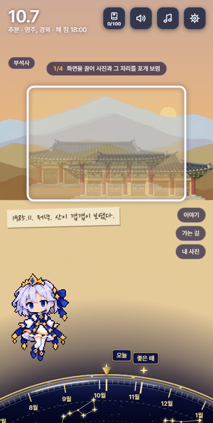 | 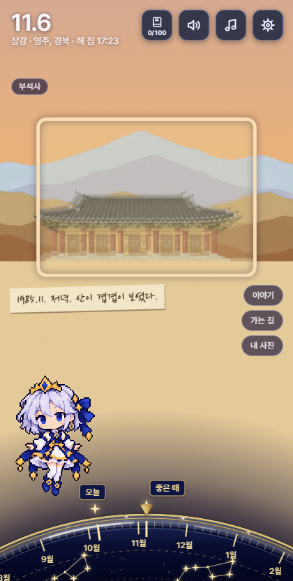 | 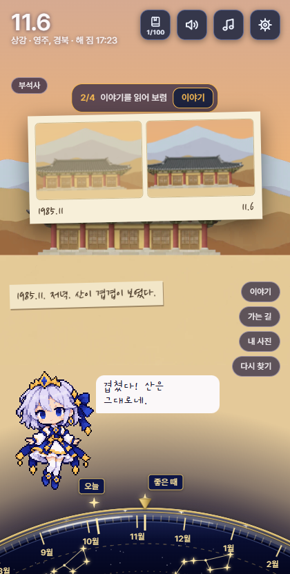 |

| 4. 일본어로 본 같은 장면 | 5. 설정(중국어) | 6. 소리를 끄면 소라가 "쉬잇" 한다 |
|:---:|:---:|:---:|
| 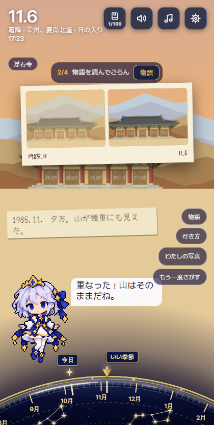 | 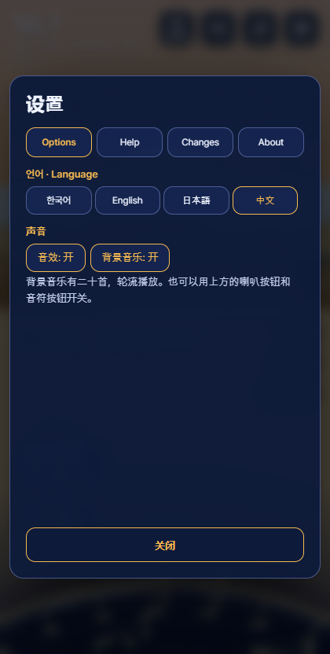 | 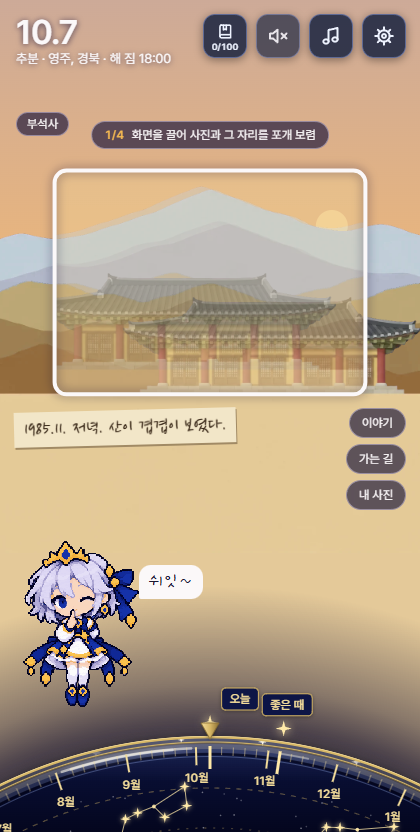 |

| 7. 수첩의 지도. 점이 칸 100개다 | 8. 수첩의 칸 목록(일본어) | 9. 이야기 카드와 문제 |
|:---:|:---:|:---:|
| 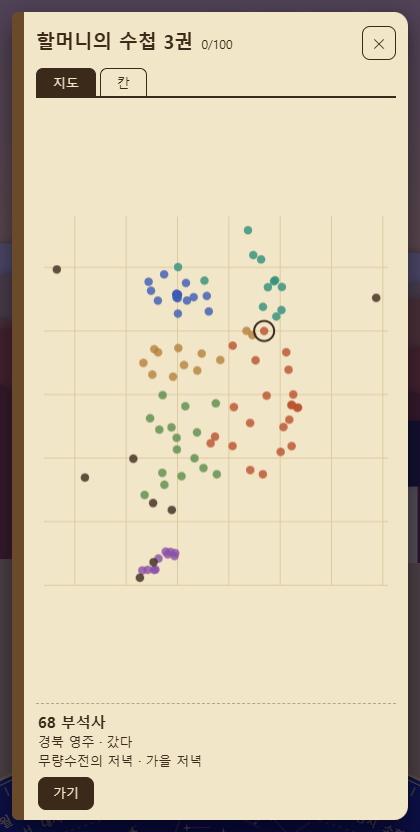 | 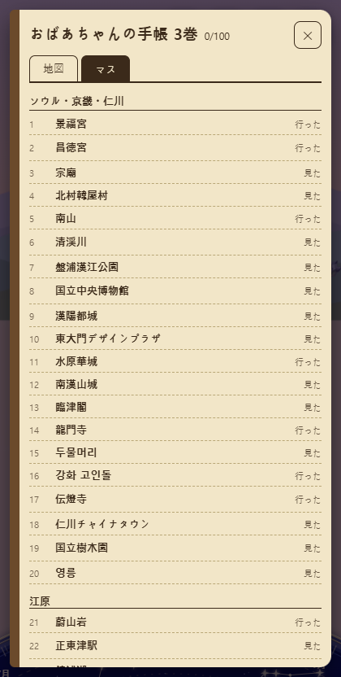 | 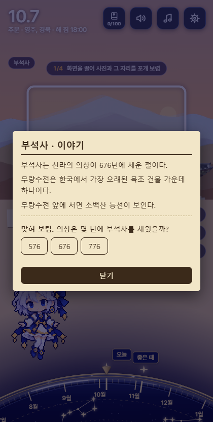 |

| 10. 가는 길(중국어) | 11. 첫 칸 첨성대 | 12. 사진 속에만 수학여행의 아이들이 있다 |
|:---:|:---:|:---:|
| 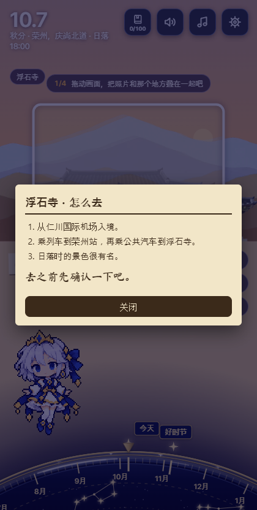 | 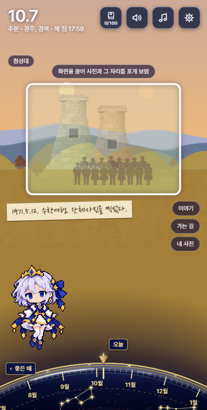 | 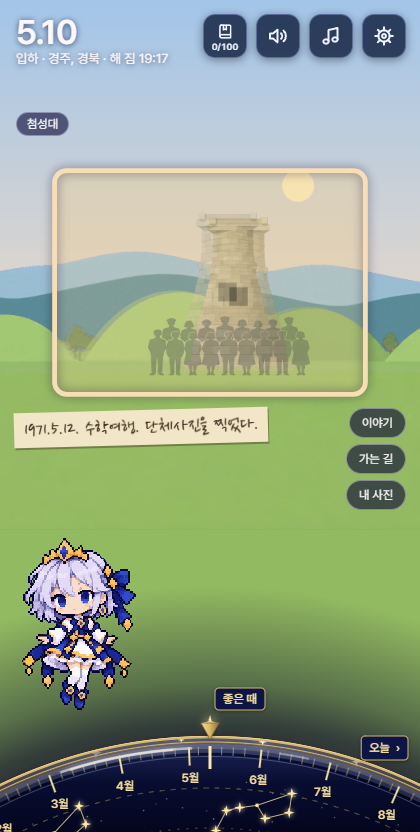 |

| 13. 첨성대를 찍은 엽서(일본어) |
|:---:|
| 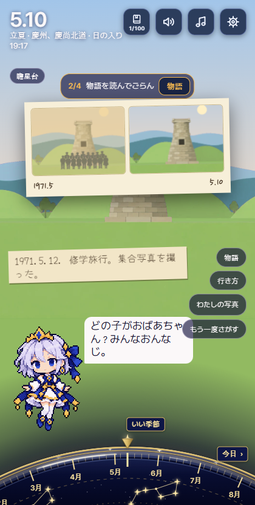 |

- 원본: [docs/overlay-proto.html](docs/overlay-proto.html). `docs` 폴더를 통째로 내려받아 브라우저로 열면 된다(그림과 음악이 `docs/assets`, `docs/mock` 에 있다). 손전화로 보면 가장 잘 알 수 있다.
- 화면 위쪽을 끌면 소라가 난다. 그림은 세 겹이고 가까운 겹일수록 많이 밀린다. 그래서 할머니가 섰던 한 자리에서만 세 겹이 모두 사진과 포개진다.
- 그 자리에서 14픽셀 안에 멈추면 저절로 끌려가 찍힌다. 찍히면 바랜 사진과 오늘 사진이 나란한 엽서가 된다.
- 첨성대 칸의 사진은 1971년 5월 수학여행의 단체사진이다. 사진 속에는 교복 입은 아이들의 실루엣이 탑 앞에 줄지어 있고, 오늘 풍경에는 없다. 얼굴은 그리지 않는다.
- 맨 아래 120픽셀이 계절 다이얼이다. 눈금 한 칸(12픽셀)이 5일이고, 73칸이 한 해다. 돌리면 봄, 여름, 가을, 겨울의 그림이 녹아 바뀐다. 겨울에는 풀밭이 눈으로 덮이고, 가을에는 풀이 누렇고 나무가 붉다. 돌탑과 기와는 그대로다.
- 다이얼의 움직임과 소리는 시간 한량의 다이얼 시험판에서 그대로 옮겼다. 좋은 때에서 한 칸 안에 멈추면 그날에 걸린다. 눈금이 지나갈 때마다 바늘이 1픽셀 내려앉는다.
- 다이얼의 생김새는 시간 한량(2권)의 다이얼 그대로다. 짙은 남색의 두꺼운 유리, 은은한 금빛 가장자리, 유리 속에서 함께 도는 북두칠성과 별가루, 테에 맺혀 깜박이는 빛, 굴릴 때 유리 위의 반짝임. 2권의 그리는 코드를 옮겨 왔다.
- 다이얼 둘레의 땅은 남색 그늘로 어둡게 눌렀다. 밝은 풀밭 위에서도 금빛 테와 유리의 빛이 보이게 하려는 것이다.
- 볼 것이 있는 날에는 밝은 눈금, 테 위의 별, 딱지가 붙는다. "좋은 때"와 "오늘"이다. 화면 밖에 있으면 다이얼 끝에 딱지가 뜨고, 그쪽 끝을 누르면 그날로 구른다.
- 다이얼의 짧은 눈금은 5일마다, 긴 눈금은 달이 바뀌는 날에 선다. 절기의 이름은 위쪽 날짜 아래에 보인다. 한국어에서는 입동, 일본어와 중국어에서는 立冬이다.
- 글씨는 1권, 2권과 같은 세 벌이다. 화면은 Pretendard, 할머니는 나눔손글씨 펜, 소라의 말풍선은 개구. 글꼴 파일을 함께 싣는다.
- "이야기"를 누르면 카드 세 문장과 문제 하나가 펼쳐진다. 답을 고르면 할머니의 말이 손글씨로 뜬다. "가는 길"은 사진을 포개 찍어 칸을 채운 뒤에 열린다. 공항에서 그 자리까지 세 줄이다.
- 해는 계산한 자리에 뜬다. 부석사의 위도와 경도, 다이얼의 날로 해 지기 40분 전의 높이와 방위를 셈한다. 다이얼을 돌리면 해가 지평선을 따라 옮겨 가고, 위쪽에 그날 해 지는 시각이 보인다(10.7은 18:00, 11.6은 17:23, 동지는 17:12). 여름에는 해가 북서쪽으로 져서 그림 밖으로 나간다.
- "내 사진"을 누르면 그 자리에서 정말 찍은 사진을 붙일 수 있다. "그 자리에서 찍기"는 카메라 화면 위에 할머니의 사진을 반투명으로 겹쳐 놓아, 게임에서 하던 포개기를 현실에서 하게 한다. 사진첩에서 골라 붙일 수도 있다. 붙이면 엽서가 석 장이 되고(할머니, 소라, 나), 수첩에 "다녀온 곳"이 따로 세어진다. 사진은 그 기기에만 남고 어디로도 보내지 않는다.
- 수첩 단추를 누르면 수첩이 열린다. 지도에는 칸 100개가 점으로 찍혀 있고, 점을 누르면 그 칸의 이름이 보인다. 칸 목록은 권역 일곱으로 나뉜다. 채운 칸은 금빛이 되고 기억된다. 그림이 있는 칸은 점 가운데가 희다. "가기"를 누르면 그 칸으로 옮겨 간다.
- 수첩의 좌표와 일본어, 중국어, 영어 이름은 위키백과와 위키데이터에서 긁은 바탕이다. 일본어 이름은 100칸 가운데 75칸, 중국어 이름은 69칸에 있다. 영어 이름은 100칸에 다 있는데, 70칸은 영어 위키백과의 제목이고 30칸은 손으로 적은 로마자 표기다. 아직 이름이 없는 칸만 한글로 보인다. 밖에서 가져온 것의 출처는 [THIRD-PARTY.md](THIRD-PARTY.md)에 모두 적었다.
- 위쪽 오른쪽에 단추 넷이 있다. 수첩(채운 칸 수), 효과음, 배경 음악, 설정. 아이콘과 유리 단추는 우주 한량(1권)의 것을 그대로 가져왔다.
- 설정에서 말을 고른다. 한국어, 영어, 일본어, 중국어(간체). 설정의 갈래는 넷이다: Options, Help(도움말), Changes(바뀐 것들), About.
- 사진 틀 위의 안내 줄이 지금 할 일을 알려 준다. 사진 포개기(1/4), 이야기(2/4), 가는 길(3/4), 다음 칸(4/4)의 차례다.
- 처음 열면 수첩 첫 장의 쪽지가 보인다. 할머니의 네 줄과 소라의 한마디를 읽고 "첫 장 펴기"를 누르면 첨성대가 열린다. 주소에 `#intro` 를 붙이면 다시 볼 수 있다.
- 파일로 열거나 localhost 에서 열면 맨 위에 시험용 단추 둘이 붙는다. "모든 답사 기록 초기화"는 채운 칸과 내 사진을 지우고 인트로부터 다시 열고, "모든 임무 완료"는 100칸을 채운 것으로 한다. 고르지 않으면 기기의 말을 따르고, 고른 것은 기억한다. 지명, 절기, 단추의 글은 고른 말 하나로만 적는다. 한국어면 부석사, 일본어와 중국어면 浮石寺다.
- 설정에는 갈래가 둘 있다. Options(말, 소리)와 Changes(바뀐 것들). Changes 쪽은 우주 한량의 것과 같은 꼴이다. 날마다 무엇이 바뀌었는지 한 줄씩 보이고, 맨 위에 만들기 시작한 날과 오늘로 며칠째인지가 적힌다. 줄은 [docs/바뀐-것들.md](docs/바뀐-것들.md)에서 온다.
- 효과음과 배경 음악을 따로 켜고 끈다. 배경 음악은 스무 곡이다. 돌담길, 대숲, 산사, 숨비소리처럼 팔도의 풍경에서 이름을 땄고, 여덟 곡은 우리 민요의 다섯 음으로 지었다. 울리는 법은 우주 한량의 것이다. 소리 파일이 없고 브라우저가 그 자리에서 만든다. 화면을 처음 누른 뒤부터 난다.
- 소리나 음악을 끄면 소라가 손가락을 입에 대고 "쉬잇" 한다. 이것도 우주 한량에서 가져왔다.
- 할머니의 메모도 고른 말 하나로만 적는다. 일본어와 중국어의 손글씨 글꼴은 임시다(Yomogi, Ma Shan Zheng).
- 수첩의 지도에 땅이 그려진다. Natural Earth의 바닷가 선이다(저작권 없음).

시험판이라 게임 코드가 아니다. 땅 그림은 챗GPT의 그림 그리기로 받은 것이다([발주서 1](docs/art-order-1.md)). 한 자리를 앞뒤로 나눈 겹 석 장이고, 사진에만 있는 아이들은 한 장 더 받았다. 산과 고분은 실제로 보이는 모양이 아니고, 세부는 사진과 견주지 않았다. 그림이 보는 쪽(부석사는 남서, 첨성대는 서)도 어림이다. 절기 날짜는 어림이라 하루쯤 어긋날 수 있다. 화면의 일본어와 중국어는 1권의 사전과 번역 시험에서 가져온 것, 그리고 임시 번역이다. 원어민이 보지 않았다.

## 번역 시험 1차

원어민 없이 기계 번역 두 벌과 역번역으로 일본어를 맞출 수 있는지 열 칸 101줄로 시험했다.

- 문장은 101줄 가운데 99줄이 뜻 그대로 돌아왔다.
- 고유명사와 용어는 10줄에서 틀렸다. 부용대가 浮島台로, 장경판전이 経蔵堂으로 나왔다.
- 한자가 틀려도 역번역은 바르게 나온다. 正東進을 되돌리면 "정동진"이다. 그래서 이름은 기계에 맡기지 않고 손으로 확인한 이름표를 쓰기로 했다.

자세한 것은 [translation-test/README.md](translation-test/README.md)에 있다.

## 무엇을 하는 게임인가

- 날아서 가고, 걸어서 보고, 계절을 돌린다.
- 수첩의 칸은 100개다. 경복궁부터 한라산 백록담까지, 오늘 외국인이 갈 수 있는 한국의 자리 100곳이다.
- 100칸 가운데 40칸에는 할머니가 1970년대에서 90년대에 찍은 사진이 붙어 있다. 같은 자리에서 같은 구도로 다시 찍으면 바랜 사진 옆에 새 사진이 붙는다.
- 칸마다 "가는 길"이 세 줄 붙는다. 공항이나 항구에서 그 자리까지 가는 법이다. 3권은 게임을 끄고 정말 가 볼 수 있는 유일한 권이다.
- 다녀와서는 그 자리에서 찍은 내 사진을 게임의 사진 옆에 붙인다. 카메라 화면에 할머니의 사진을 겹쳐 놓고 찍을 수 있다.
- 지명은 설정에서 고른 말 하나로만 적는다.
- 마지막 칸은 할머니가 세 번 올랐는데 세 번 모두 안개였던 한라산 백록담이다.

## 지키는 것

- 자리는 모두 실제이고, 오늘 외국인이 들어갈 수 있는 곳만 둔다. 지어낸 자리와 사람은 없다. 할머니만 지어낸 인물이다.
- 사람의 얼굴은 그리지 않는다. 가게 이름과 상품 이름은 없다.
- 세 나라 사이의 일은 자리와 남은 것으로만 적는다. 영유권 다툼이 있는 자리는 넣지 않는다.
- 시간에 쫓기지 않는다. 죽지 않고, 점수가 깎이지 않는다.
- 서버, 계정, 광고가 없다.
- 글보다 그림이 먼저다. 할머니 메모 한 줄 25자, 소라 한 줄 25자, 카드 3문장, 가는 길 3줄을 넘기지 않는다.

## 1권, 2권과의 관계

- 인물(소라, 할머니), 세 목소리(메모, 덧글, 답장), 다이얼을 그대로 잇는다.
- 3권은 1권, 2권 없이 혼자 선다. 1권은 한국어, 영어, 일본어, 중국어(간체)가 있지만 2권은 아직 한국어판뿐이기 때문이다.
- 번역은 원어민 없이 기계 번역으로 하되 한국어의 느낌을 살린다. 1권의 일본어, 중국어 번역 3,658줄을 본으로 삼는다.
- 1권은 Vite와 Babylon.js로 만들었고, 2권도 같은 것으로 첫 토막을 짓는 중이다.

## 라이선스

밖에서 가져온 자료와 그 조건은 [THIRD-PARTY.md](THIRD-PARTY.md)에 있다.

[LICENSE](LICENSE)는 두 갈래다.

- 코드와 문서는 MIT다.
- 소라 캐릭터와 그 그림은 MIT가 아니다. 모든 권리를 남겨 둔다. 1권, 2권과 같은 조건이다.
