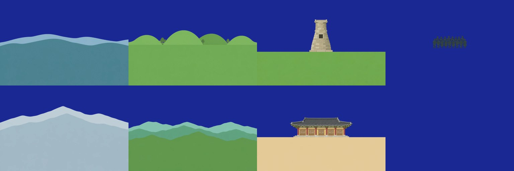

# 그래픽 발주서 1: 두 칸의 겹 그림 7장

게임 "Korea Oddity — 팔도 한량"의 땅 그림을 처음 주문한다. 그림은 직접 그리지 않고 챗GPT의 그림 그리기에 맡긴다(사용자, 2026.10.7: "그래픽은 gpt 외주 보내기로 했잖아"). 시간 한량(2권)의 발주서 1, 2와 같은 길이다.

- 쓴 날: 2026.10.7. 받은 날: 2026.10.7
- 그리는 손: 챗GPT의 그림 그리기. Codex CLI로 넣는다(`tools/art-order.sh`, 2권에서 가져왔다).
- 주문한 것: 그림이 있는 두 칸(63 첨성대, 68 부석사)의 겹 그림 7장. 7장 모두 한 번에 받았고 다시 주문한 것은 없다.

받은 7장(자홍색을 지우고 남색 바탕에 얹은 것. 윗줄이 첨성대의 먼 산, 고분, 탑, 아이들이고 아랫줄이 부석사의 먼 산, 산줄기, 무량수전):


- 그림체와 지킬 것은 2권의 `docs/art-order-test-10.md` 2절, 3절을 따른다. 3권에서 달라진 것만 적는다.

## 1. 2권과 달라진 것: 한 장이 아니라 겹으로 받는다

2권은 한 자리에 "그때"와 "오늘" 2장을 받아 겹쳐 녹인다. 3권은 다르다.

- 3권의 간판 장면은 할머니의 사진을 오늘 풍경에 포개는 것이다. 소라가 움직이면 가까운 것은 많이, 먼 것은 조금 밀려야 한 자리에서만 사진과 포개진다.
- 그래서 한 자리의 그림을 앞뒤로 나눈 겹 3장으로 받는다. 맨 뒤(먼 산), 가운데, 맨 앞(건물과 땅).
- 할머니의 사진은 따로 받지 않는다. 같은 겹을 할머니가 섰던 자리에서 본 대로 놓고 바랜 색을 입혀 게임이 만든다. 사진에만 있는 것(수학여행의 아이들)만 겹 한 장으로 더 받는다.
- 계절도 따로 받지 않는다. 겹 위에 철의 색을 입힌다(겨울은 흰빛, 가을은 붉은빛). 기획서 4절의 "색판만 갈면 계절이 바뀐다"를 받은 그림에 맞춘 것이다.

| 무엇 | 2권 | 3권 |
|---|---|---|
| 한 자리의 그림 | 그때 1장, 오늘 1장 | 겹 3장. 사진에만 있는 것이 있으면 1장 더 |
| 빈 자리 | 하늘을 `#ff00ff` 로 | 그릴 것이 없는 자리를 모두 `#ff00ff` 로. 받아서 지운다(`tools/key-sky.py`, 2권에서 가져왔다) |
| 겹의 아래쪽 | 해당 없음 | 겹의 윤곽 아래는 그 겹의 색으로 그림 맨 아래까지 채운다. 겹을 위아래로 밀어도 빈 데가 생기지 않게 |
| 빛 | 한낮의 고른 빛 | 같다 |
| 참고 그림 | 소라 `idle-1.png` | 같다. 그리고 먼저 받은 겹 1장(`cheom-front.png`)을 그림체의 기준으로 넣는다 |

## 2. 규격

| 항목 | 값 |
|---|---|
| 크기 | 1536×1024 (가로) |
| 형식 | PNG로 받아 WebP로 바꾼다 |
| 땅의 높이 | 건물의 발과 산의 발은 그림 아래에서 45% 높이쯤 |
| 가로 | 왼쪽 끝에서 오른쪽 끝까지 이어지게. 게임이 좌우로 민다 |
| 주인공 | 맨 앞 겹의 건물은 가로 한가운데에 하나 |

## 3. 주문한 7장

| 파일 | 칸 | 겹 | 묘사 |
|---|---|---|---|
| `cheom-far` | 63 첨성대 | 맨 뒤 | 멀리 보이는 낮은 산줄기 두 겹. 옅은 청회색과 청록색 |
| `cheom-mid` | 63 첨성대 | 가운데 | 풀로 덮인 둥근 신라 고분 넷. 사이에 작은 나무 서너 그루 |
| `cheom-front` | 63 첨성대 | 맨 앞 | 평평한 풀밭 한가운데에 첨성대. 병 모양의 돌탑, 가운데에 네모난 창, 맨 위에 네모난 돌 틀 |
| `cheom-class` | 63 첨성대 | 사진에만 | 1971년 수학여행의 학생 열일곱 명이 두 줄로 선 실루엣. 얼굴 없음 |
| `bus-far` | 68 부석사 | 맨 뒤 | 아주 멀리 보이는 높은 산줄기 두 겹. 옅은 회청색 |
| `bus-mid` | 68 부석사 | 가운데 | 겹겹이 겹친 산줄기 세 겹. 가까울수록 짙은 풀색 |
| `bus-front` | 68 부석사 | 맨 앞 | 흙마당 한가운데에 무량수전. 정면 다섯 칸, 붉은 갈색 기둥 여섯, 짙은 회색 기와의 팔작지붕 |

묘사는 처음 잡아 본 것이다. 원 자료(사진)와 견주지 않았다. 첨성대의 돌이 몇 단인지, 무량수전의 칸과 지붕의 생김새, 그 자리에서 실제로 보이는 산의 모양은 게임에 굳히기 전에 확인한다.

## 4. AI에 넣은 문장

모든 주문의 앞머리(그림체와 지킬 것)다. `tools/art-order.sh` 가 이 앞에 "이미지 생성 기능으로 그려 저장하라"는 말을 더 붙인다.

```text
크기 1536x1024(가로), PNG.

그림체: 색종이를 오려 겹친 듯한 납작한 그림. 겹마다 한 가지 색으로 고르게 칠하고,
윤곽선 없음. 번지는 색, 붓 자국, 사진 같은 질감 없음. 겹 사이에 아주 옅은 그림자만.
참고 그림(idle-1.png)의 캐릭터와 한 화면에 놓이므로 색이 너무 쨍하지 않게.
이 캐릭터는 그리지 말고 색의 세기만 참고할 것.

이 그림은 게임에서 여러 장을 앞뒤로 겹쳐 쓰는 "겹" 한 장이다. 그래서:
- 그릴 것이 없는 자리는 모두 #ff00ff(자홍색) 한 가지 색으로 고르게 칠할 것.
  그 자리에 구름, 해, 달, 별, 새, 무늬, 그러데이션을 넣지 말 것.
- 한낮의 고른 빛으로. 노을, 밤, 긴 그림자를 넣지 말 것.
- 사람의 얼굴, 글자, 숫자를 넣지 말 것.
- 자홍색(#ff00ff)이나 그와 비슷한 분홍, 보라를 그림 안에 쓰지 말 것.
```

겹마다 붙인 문장의 본보기(첨성대의 맨 앞 겹)다. 나머지 여섯은 3절의 묘사를 같은 꼴로 풀어 썼다.

```text
이 겹: 맨 앞 겹. 한국 경주의 첨성대(7세기 신라의 돌 천문대)가 풀밭 위에 서 있다.
- 첨성대는 그림의 가로 한가운데에 하나. 병 모양의 돌탑: 네모난 기단 위에 아래가 넓고
  위로 갈수록 좁아지는 둥근 몸통, 몸통 가운데 높이에 남쪽으로 난 네모난 창 하나,
  맨 위에 우물 정(井)자 모양으로 짠 네모난 돌 틀 두 단. 가로로 돌을 쌓은 단이 스물일곱 줄쯤 보인다.
  돌의 색은 옅은 회갈색.
- 탑의 높이는 그림 높이의 30%쯤. 탑의 발은 그림 아래에서 45% 높이에 닿는다.
- 탑의 발 높이(아래에서 45%)부터 그림 맨 아래까지는 고르게 깎은 평평한 풀밭. 풀색 한두 가지.
  풀밭의 윗가장자리는 거의 수평인 한 줄.
- 풀밭 윗가장자리보다 위는 탑을 뺀 나머지가 모두 자홍색(#ff00ff). 산, 나무, 다른 건물, 울타리, 사람 없음.
- 정면에서 멀찍이 본 구도.
```

둘째 장부터는 먼저 받은 `cheom-front.png` 를 참고로 함께 넣고 이 말을 붙였다.

```text
참고 그림 cheom-front.png 는 같은 게임에서 먼저 받은 겹이다. 그림체, 색의 세기, 종이를 오린 느낌을
이 그림과 똑같이 맞출 것. 이 그림의 탑과 풀밭을 다시 그리지는 말 것.
```

## 5. 주문한 차례

1. `cheom-front` 한 장을 먼저 받았다. 1분 48초 걸렸다. 빈 자리가 고른 자홍색이고 탑과 풀밭만 있어 그대로 쓸 수 있었다.
2. 그 그림을 참고로 넣고 나머지 6장을 한꺼번에 넣었다.
3. `tools/key-sky.py` 로 자홍색을 지우고 WebP로 바꿔 `docs/assets/scenes/` 에 두었다.

## 6. 받고 확인한 것

| 확인 | 결과 |
|---|---|
| 빈 자리가 한 가지 자홍색인가 | 7장 모두 그렇다. 지운 뒤 가장자리에 분홍 테가 남지 않았다 |
| 글자, 숫자, 얼굴이 없는가 | 없다. 아이들은 한 가지 색의 실루엣이다 |
| 겹의 윤곽 아래가 맨 아래까지 채워졌는가 | 그렇다. 아이들 겹만 바탕 전체가 비어 있다(그렇게 주문했다) |
| 왼쪽 끝에서 오른쪽 끝까지 이어지는가 | 그렇다 |
| 7장이 한 사람이 그린 것으로 보이는가 | 그렇다. 먼저 받은 한 장을 참고로 넣은 것이 통했다 |
| 크기가 주문대로인가 | **아니다.** 탑은 그림 높이의 30%로 주문했는데 38%로 왔고, 무량수전은 너비 40%로 주문했는데 48%로 왔다. 게임이 그림을 화면 너비의 1.45배로 줄여 놓아 맞췄다 |
| 땅의 높이가 아래에서 45%인가 | **아니다.** 겹마다 다르다. `tools/key-sky.py` 가 잰 값을 게임에 적어 맞춘다 |

잰 값(위에서부터의 비율)이다. 시험판의 `HOR`, `FOOT` 에 들어 있다.

| 파일 | 윤곽이 가장 낮은 높이 | 맨 아래의 색 | 크기(WebP) |
|---|---:|---|---:|
| `cheom-far` | 0.498 | `#4b8291` | 16KB |
| `cheom-mid` | 0.497 | `#70aa54` | 18KB |
| `cheom-front` | 0.604 | `#6ea84d` | 17KB |
| `cheom-class` | 발이 0.563 | 없음 | 21KB |
| `bus-far` | 0.435 | `#a3b9c7` | 15KB |
| `bus-mid` | 0.503 | `#60974e` | 16KB |
| `bus-front` | 0.604 | `#e4ca99` | 28KB |

## 7. 아직 보지 않은 것

- 세부가 사실과 맞는지. 첨성대는 돌이 27단이고 창 아래가 12단인데 받은 그림은 세어 보지 않았다. 맨 위 돌 틀의 생김새, 무량수전의 공포와 창살, 지붕의 꼴도 사진과 견주지 않았다.
- 그 자리에서 실제로 보이는 산의 모양. 받은 산은 지어 그린 것이다.
- 철의 색을 그림 위에 입히는 방법. 지금은 한 가지 색을 반투명으로 덮는다. 가을에 온 화면이 주황빛으로 탁해진다. 겹마다 철의 색을 따로 받을지, 입히는 방법을 다듬을지 정해야 한다.
- 사용자가 그림체를 좋다고 하는지.

## 8. 다시 주문하는 법

주문 문장과 받은 원본은 `assets/codex/order1/` 에 있다. 이 폴더는 커밋하지 않는다. 다시 주문할 때는 4절의 앞머리와 3절의 묘사로 문장을 다시 쓴다.

```bash
bash tools/art-order.sh assets/codex/order1 assets/codex/order1/cheom-mid.txt cheom-mid.png assets/codex/order1/cheom-front.png assets/codex/order1/idle-1.png
```

```bash
py tools/key-sky.py assets/codex/order1/cheom-mid.png docs/assets/scenes/cheom-mid.webp
```
